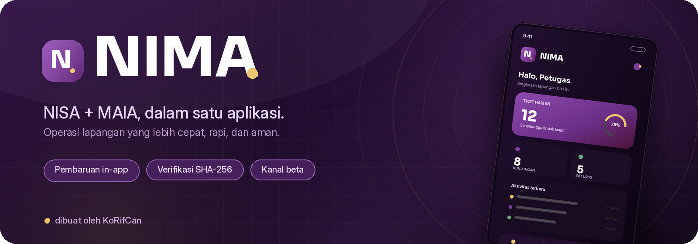
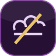

<div align="center">



<br />


<br /><br />

<a href="https://github.com/KoRifCan/nima-releases/releases/latest">
  
</a>
&nbsp;&nbsp;
<a href="https://github.com/KoRifCan/nima-releases/releases">
  
</a>

<br /><br />

**Aplikasi operasi lapangan untuk petugas MyRepublic.**<br />
<sub>NISA + MAIA dalam satu aplikasi · Tanpa akun GitHub · Tanpa iklan</sub>

</div>


## Kerja lapangan, dalam satu genggaman

NIMA menyatukan alur **NISA** dan **MAIA** tanpa WebView. Tiket, FAT Loss,
peta, ekspor laporan, dan aktivitas operasional lainnya tersedia dalam satu
aplikasi Android native yang ringan dan cepat.

Halaman ini adalah **kanal unduhan resmi** NIMA. Yang dipublikasikan di sini
hanya berkas pemasangan dan pembaruan — tidak ada data pelanggan, kata sandi,
atau token.

<table>
<tr>
<td align="center" width="33%" valign="top">
<br />
<b>Pembaruan di aplikasi</b><br />
<sub>Cek, unduh, dan pasang versi baru tanpa membuka browser.</sub>
</td>
<td align="center" width="33%" valign="top">
<br />
<b>Unduhan terverifikasi</b><br />
<sub>APK ditandatangani kunci rilis NIMA dan dilengkapi SHA-256.</sub>
</td>
<td align="center" width="33%" valign="top">
<br />
<b>Tetap produktif</b><br />
<sub>Antrean offline menyimpan pekerjaan saat sinyal terputus.</sub>
</td>
</tr>
<tr>
<td align="center" width="33%" valign="top">
<br />
<b>Peta dan rute</b><br />
<sub>Lihat tiket di peta dan susun rute multi-titik.</sub>
</td>
<td align="center" width="33%" valign="top">
<br />
<b>Laporan siap kirim</b><br />
<sub>Ekspor PDF dan CSV langsung dari perangkat.</sub>
</td>
<td align="center" width="33%" valign="top">
<br />
<b>Data tetap privat</b><br />
<sub>Kunci aplikasi, ID tersamarkan, dan sesi berbatas waktu.</sub>
</td>
</tr>
</table>


## Sebelum memasang

| | |
|:--|:--|
| **Android** | 7.0 (API 24) atau lebih baru |
| **Arsitektur** | ARM64 (`arm64-v8a`) |
| **Ukuran unduhan** | sekitar 29 MB |
| **Akun** | NISA/MAIA yang aktif |

## Mulai dalam tiga langkah

| 1 | 2 | 3 |
|:--:|:--:|:--:|
| **Unduh**<br /><sub>Buka halaman rilis terbaru dan ambil berkas `.apk`.</sub> | **Pasang**<br /><sub>Izinkan “Instal aplikasi tak dikenal” bila diminta.</sub> | **Masuk**<br /><sub>Buka NIMA dan login dengan akun Anda.</sub> |

> [!IMPORTANT]
> Jika sebelumnya pernah memasang build uji **0.4.3 atau lebih lama**,
> hapus NIMA sekali, reboot ponsel, lalu pasang versi terbaru. Build lama
> memakai kunci tanda tangan berbeda. Setelah versi 0.5.0 atau lebih baru
> terpasang, pembaruan berikutnya tidak perlu menghapus aplikasi.

> [!NOTE]
> Aplikasi memerlukan koneksi internet untuk login dan sinkronisasi. Tidak
> perlu akun GitHub untuk mengunduh atau memperbarui NIMA.


## Pembaruan tanpa ribet

Buka **Pengaturan → Pembaruan aplikasi** di NIMA:

- **Cek pembaruan** — memeriksa versi terbaru kapan saja.
- **Cek otomatis** — aktif secara default, paling sering sekali setiap 6 jam.
- **Ikuti pra-rilis (beta)** — mencoba versi lebih awal; nonaktif secara default.
- **Unduh & pasang** — mengunduh APK, memverifikasi SHA-256 bila tersedia,
  lalu membuka installer Android.

| Kanal | Status di GitHub | Terlihat di aplikasi |
|:--|:--|:--|
| **Stabil** | Rilis biasa | ✅ Semua pengguna |
| **Beta** | Ditandai *pre-release* | 🧪 Hanya bila kanal beta diaktifkan |
| **Draf** | Belum dipublikasikan | 🚫 Tidak pernah |

Rilis draf tidak pernah dikirim ke aplikasi, sehingga versi yang masih
disiapkan aman tersimpan tanpa terdeteksi. Pengguna kanal stabil tidak akan
terganggu oleh rilis beta.


## Unduhan aman

Setiap rilis menyertakan berkas checksum
`nima-<versi>-arm64.apk.sha256`. Cocokkan sebelum memasang:

**Linux / macOS**

```bash
sha256sum -c nima-<versi>-arm64.apk.sha256
```

**Windows (PowerShell)**

```powershell
Get-FileHash .\nima-<versi>-arm64.apk -Algorithm SHA256
```

Bandingkan hasilnya dengan isi berkas `.sha256` di halaman rilis. Aplikasi
juga memverifikasi checksum secara otomatis bila aset tersebut tersedia.


## Pertanyaan yang sering muncul

<details>
<summary><b>Apakah APK ini resmi?</b></summary>

Ya. APK diterbitkan oleh pembuat NIMA dan ditandatangani dengan kunci rilis
NIMA yang tetap, sehingga pembaruan dapat dipasang di atas versi sebelumnya.
Unduh hanya dari halaman rilis ini.

</details>

<details>
<summary><b>Mengapa Play Protect menampilkan peringatan?</b></summary>

APK ini dipasang di luar Play Store, sehingga Android dapat menampilkan
peringatan. Selama berkas berasal dari halaman rilis ini dan checksum-nya
cocok, berkas tersebut adalah berkas resmi NIMA.

</details>

<details>
<summary><b>Muncul “Aplikasi tidak terpasang”. Apa yang harus dilakukan?</b></summary>

Biasanya karena versi lama memakai kunci tanda tangan berbeda. Hapus NIMA
sekali, reboot ponsel, lalu pasang ulang. Data aplikasi akan hilang dan perlu
login ulang.

</details>

<details>
<summary><b>Versi beta tidak muncul.</b></summary>

Buka **Pengaturan → Pembaruan aplikasi**, lalu aktifkan
**Ikuti pra-rilis (beta)**. Setelah itu tekan **Cek pembaruan**.

</details>

<details>
<summary><b>Apakah data saya dikirim ke GitHub?</b></summary>

Tidak. GitHub hanya dipakai untuk membaca daftar rilis dan mengunduh APK.
Data operasional tetap dikirim ke layanan NISA/MAIA seperti biasa.

</details>

<details>
<summary><b>Apakah saya perlu akun GitHub?</b></summary>

Tidak. Aplikasi tidak meminta login GitHub dan tidak menyimpan token GitHub.

</details>

<details>
<summary><b>Di mana kode sumbernya?</b></summary>

Kode sumber disimpan di repositori privat. Repositori ini hanya berisi berkas
rilis yang boleh diunduh publik.

</details>

<details>
<summary><b>Bagaimana jika saya mengalami kendala?</b></summary>

Hubungi admin atau tim IT operasi Anda. Sertakan versi NIMA yang terpasang
(terlihat di **Pengaturan → Tentang NIMA**) dan pesan kesalahannya.

</details>


## English

<details>
<summary><b>NIMA in English</b></summary>


NIMA is the Android field-operations app that brings NISA and MAIA workflows
together for MyRepublic field officers. Download the latest APK from the
[releases page](https://github.com/KoRifCan/nima-releases/releases/latest).

- Requires Android 7.0+, an ARM64 device, and an active NISA/MAIA account.
- Updates are delivered inside the app (**Settings → App updates**), with an
  optional beta channel and automatic checks every six hours at most.
- Draft releases are never offered. Stable users only see stable releases.
- No GitHub account or token is required. Verify the download with the
  published SHA-256 checksum.

</details>


<div align="center">
<sub>Dibuat oleh <b>KoRifCan</b> · NIMA · Android ARM64</sub><br />
<sub>Kode sumber privat · Hanya berkas rilis yang dipublikasikan di sini.</sub>
</div>
